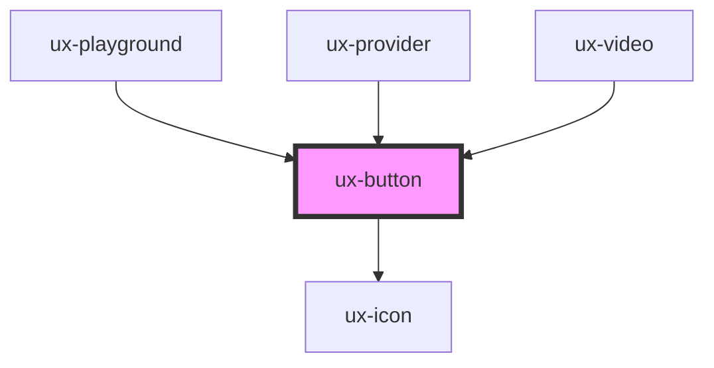

# ux-button

<!-- Auto Generated Below -->

## Properties

| Property      | Attribute      | Description | Type      | Default       |
| ------------- | -------------- | ----------- | --------- | ------------- |
| `appendIcon`  | `append-icon`  |             | `string`  | `undefined`   |
| `block`       | `block`        |             | `boolean` | `false`       |
| `color`       | `color`        |             | `string`  | `undefined`   |
| `disabled`    | `disabled`     |             | `boolean` | `false`       |
| `elevation`   | `elevation`    |             | `number`  | `0`           |
| `loading`     | `loading`      |             | `boolean` | `false`       |
| `prependIcon` | `prepend-icon` |             | `string`  | `undefined`   |
| `ring`        | `ring`         |             | `boolean` | `false`       |
| `rounded`     | `rounded`      |             | `boolean` | `false`       |
| `shadow`      | `shadow`       |             | `boolean` | `true`        |
| `size`        | `size`         |             | `string`  | `'md'`        |
| `text`        | `text`         |             | `string`  | `undefined`   |
| `type`        | `type`         |             | `string`  | `'secondary'` |

## Dependencies

### Used by

 - [ux-playground](../ux-playground)
 - [ux-provider](../ux-provider)
 - [ux-video](../ux-video)

### Depends on

- [ux-icon](../ux-icon)

### Graph

----------------------------------------------

*Built with [StencilJS](https://stenciljs.com/)*
